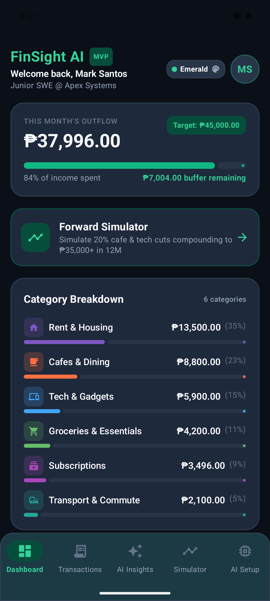
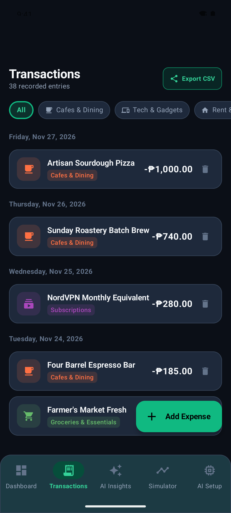
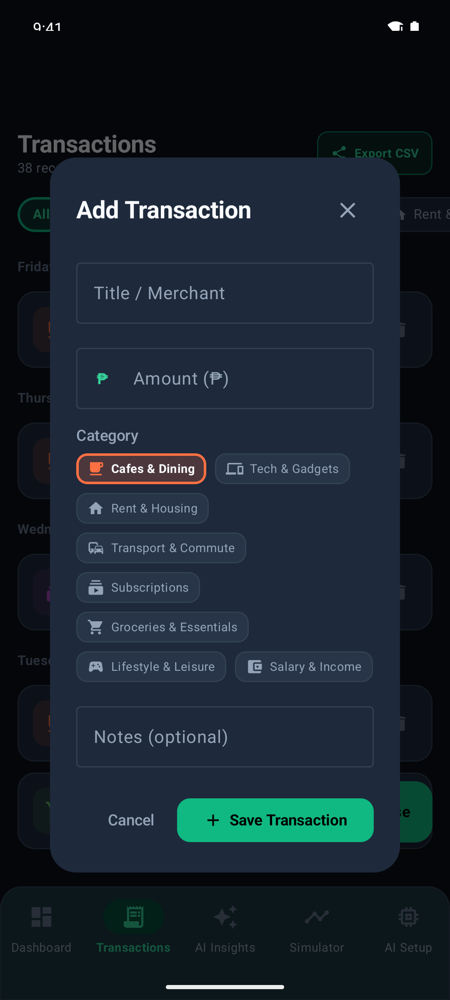
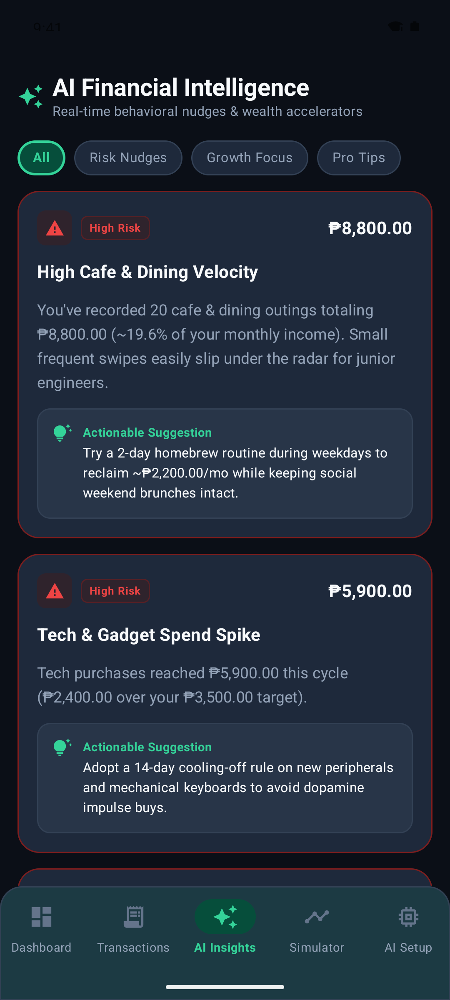
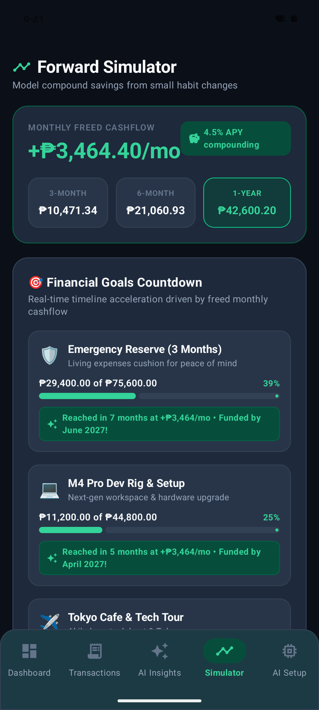
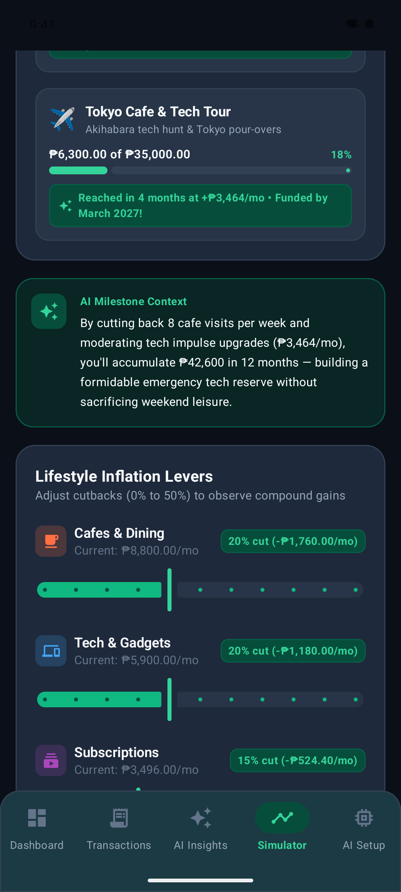
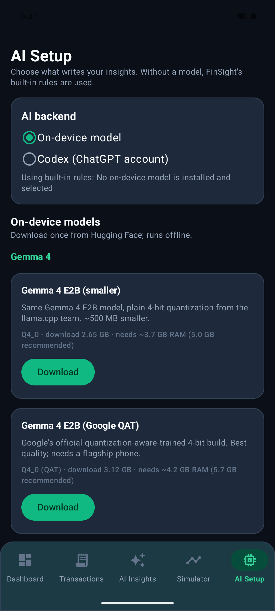
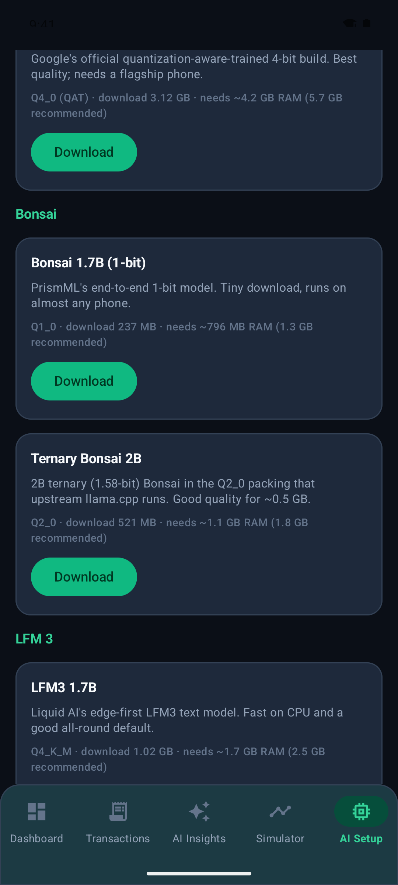
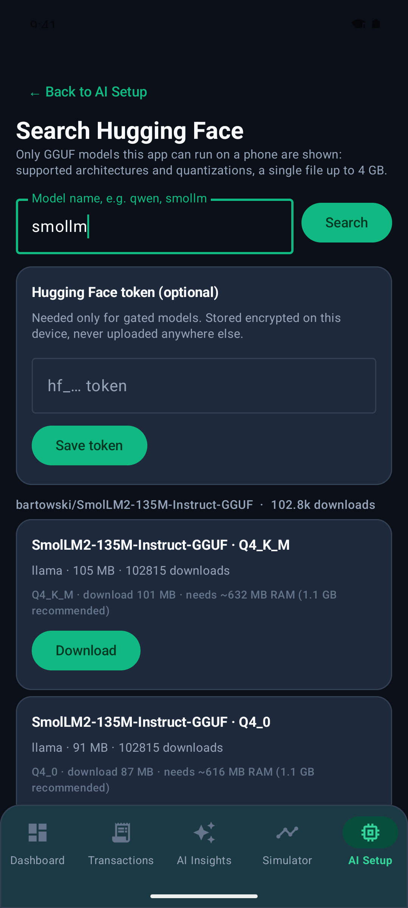
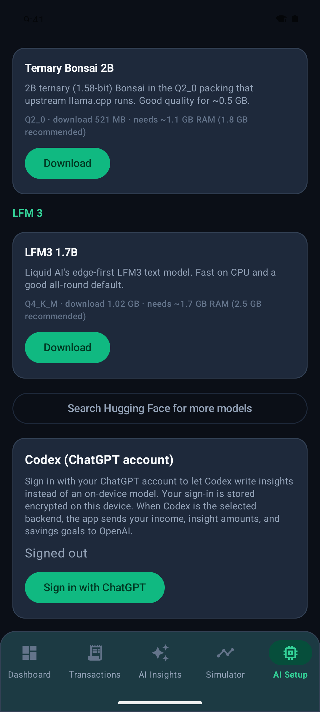

# FinSight AI 📱💡
> **Intelligent financial decision-making for early-career earners.**

<div align="center">

### ⚡ [📲 CLICK HERE TO DIRECTLY DOWNLOAD APK (`finsight-ai.apk`)](https://github.com/itsonlyfranz/finsight-android/releases/latest/download/finsight-ai.apk) ⚡
*(Automatic 1-click download • 8.6 MB • Ready to install on Android 7.0+, arm64)*

[-10B981?style=for-the-badge&logo=android&logoColor=white)](https://github.com/itsonlyfranz/finsight-android/releases/latest/download/finsight-ai.apk)
[](https://github.com/itsonlyfranz/finsight-android/raw/main/finsight-ai.apk)

</div>

> **Upgrading from v1.0.0?** v1.1.0 is signed with a new release key, so uninstall v1.0.0 first. Uninstalling deletes the app's saved data on that phone. Later updates signed with this key install over v1.1.0 and keep your saved amounts.

FinSight AI is a native Android application built with **Jetpack Compose**, **Material 3**, **SQLite on-device persistence**, and an on-device **AI Behavioral Insights & Forward Simulation Engine**. It bridges the gap between passive expense logging and active financial planning for young professionals facing early-career lifestyle inflation.

---

## 🎯 Target Audience & Persona
- **Primary Persona**: **Mark Santos**, 24 years old, single. Junior Software Engineer at Apex Systems (₱45,000/mo net income).
- **Core Challenge**: Struggles to maintain consistent savings due to lifestyle inflation, frequent cafe visits, and tech gadget impulse buys.
- **POV**: *"Young professionals need actionable financial interpretation because raw transaction numbers fail to motivate lasting behavioral change."*

---

## 📸 Live Application Screenshots (Android Device / Emulator)

| **1. The Expense Dashboard** | **2. Transaction Log & CSV Export** |
|:---:|:---:|
|  |  |
| *Monthly outflow (₱37,996.00 of a ₱45,000.00 income target), budget gauge, category breakdown, and theme switcher.* | *Grouped chronological history, category filters, CSV Export button, and "+ Add Expense" FAB.* |

| **3. Add Transaction Dialog** | **4. AI Financial Intelligence** |
|:---:|:---:|
|  |  |
| *Fast on-device CRUD with category tags, peso amount validation, and optional notes.* | *Behavioral Risk Nudges (cafe velocity, tech spend spikes) with actionable suggestions, filterable by type.* |

| **5. Forward Simulator & Goals Countdown** | **6. AI Milestone Context & Cutback Levers** |
|:---:|:---:|
|  |  |
| *Monthly freed cashflow (+₱3,464.40/mo), 3M/6M/12M compound growth (4.5% APY), and goal countdowns.* | *Goal progress, AI milestone context, and the Dining / Tech / Subscriptions cutback sliders.* |

| **7. AI Setup: Backend & Gemma 4** | **8. AI Setup: Bonsai & LFM 3 Models** |
|:---:|:---:|
|  |  |
| *Backend picker (on-device model or Codex) and the curated Gemma 4 models with download size and RAM guidance.* | *Bonsai and LFM 3 models with quantization, download size, and RAM guidance; each has Download, then Use / Delete once installed.* |

| **9. Hugging Face Model Search** | **10. Codex (ChatGPT Account), Signed Out** |
|:---:|:---:|
|  |  |
| *Search results limited to GGUF models this app can run, with size and RAM estimates (search term: "smollm").* | *Codex card before sign-in, including the note on what is sent to OpenAI when Codex is the selected backend.* |

---

## 🏗️ Architecture & Features

### 1. On-Device SQLite Persistence
- Powered by `FinSightDatabaseHelper` managing `transactions`, `budgets`, and `settings` tables.
- All changes persist permanently on device across app restarts.
- A new install starts empty: no demo transactions are added, every screen shows an empty state that says what to do next, and deleting everything never brings sample data back. Existing installs keep their saved data untouched. Amounts are in Philippine pesos (₱). Upgrading from v1.0.0 requires an uninstall, which deletes saved data.
- Tap a transaction to edit its amount, category, date and note; the trash icon deletes it.

### 2. CSV Data Export & Sharing (From Impact-Effort Matrix)
- Export transactions into RFC 4180-compliant CSV format with a single tap.
- Uses Android `FileProvider` and native system Sharesheet (`Intent.ACTION_SEND`).

### 3. AI Behavioral Insights Engine
- `AiInsightsEngine` evaluates spending velocity, cafe hopping frequency (>8 visits/mo), and tech discretionary spikes.
- Emits **Risk Nudges** (spending warnings), **Growth Focus** (positive reinforcement), and **Career Pro Tips** (13th-month pay, WFH stipends).

### 4. Goal-Oriented Forward Simulator
- Interactive cutback sliders (Dining, Tech, Subscriptions).
- Computes deterministic compound projections for 3, 6, and 12-month horizons.
- **Financial Goals Countdown**: Dynamic countdowns showing how freed cashflow speeds up savings goals. The app ships no preset goals, so a fresh Simulator shows an empty goals state.
- **AI Milestone Context**: Natural-language encouragement contextualizing saved pesos into tangible life wins.

### 5. Multi-Theme Customizer
- **Deck Emerald** (Default sleek slate & emerald green)
- **Cyber Slate** (High-contrast tech violet)
- **Midnight Blue** (Deep ocean navy & cyan)

### 6. Generative AI backends (optional, on top of the rules engine)
The deterministic engines above always compute the numbers and the default wording. In the **AI Setup** tab you can additionally let a language model *re-phrase* the nudges, the simulator explanation and each goal's milestone context:
- **On-device models** (llama.cpp, offline after download): Gemma 4 E2B, Bonsai (1-bit 1.7B, ternary 2B) and LFM 3 1.7B, all GGUF. Each card shows download size, RAM guidance, an installed-size line, **Use this model** and **Delete** (removes the files; deleting the active model falls back to the rules, or to Codex if selected). Downloads show progress, resume after a dropped connection, and cancelled/failed downloads remove their partial file.
- **Hugging Face search**: finds more GGUF models, showing *only* those this app can run (supported architecture and quantization, one file up to 4 GB, no vision projectors / split / full-precision files). Optional Hugging Face token for gated repos, stored encrypted.
- **Codex (ChatGPT account)**: sign in with the OpenAI device-code flow used by the Codex CLI, then pick which of your account's Codex models writes the insights. The sign-in is stored encrypted, and the app tells you what it sends to OpenAI when Codex is selected. See [docs/codex-login-manual-test.md](docs/codex-login-manual-test.md).
- A guard rejects any model output that mentions a money figure (₱, PHP or $) not present in the engine's facts, and any failure falls back to the rules text. Verified model repos/files/sizes: [docs/model-catalog-verification.md](docs/model-catalog-verification.md).

Build note: the on-device runtime is native code (llama.cpp **v0.9.0**, fetched by CMake at build time, arm64-v8a only). Building needs the Android NDK `28.2.13676358` and CMake `3.31.6` (`sdkmanager "ndk;28.2.13676358" "cmake;3.31.6"`) and network access to GitHub on the first build.

---

## 🧪 Testing & Verification
All unit tests run via Gradle test runner:
```bash
./gradlew testDebugUnitTest
```
- **166 JVM unit tests passing** (0 failures, 0 errors), including model catalog / Hugging Face search filter / resumable downloader / Codex auth / backend router / AI-binding suites. The original core suites are:
  - `AiInsightsEngineTest`: 6 tests
  - `ForwardSimulatorEngineTest`: 7 tests
  - `FinSightRepositoryTest`: 9 tests
  - `FinSightViewModelTest`: 6 tests
  - `CsvExporterTest`: 2 tests
  - `MainScreenViewModelTest`: 2 tests

Instrumented (emulator or device, arm64) UI and on-device tests, with the network and native runtime faked where noted:
```bash
./gradlew connectedDebugAndroidTest
# optional real-model inference test: push any small GGUF first
adb push Bonsai-1.7B-Q1_0.gguf /data/local/tmp/finsight-smoke.gguf
```
The full-app end-to-end pass (coverage map, results, and the real process-death check `scripts/e2e-process-restart.sh`) is described in [docs/e2e-test-report.md](docs/e2e-test-report.md).

---

## ⚙️ Continuous Integration
`.github/workflows/android-ci.yml` runs on every pull request and on pushes to `main`, on a **self-hosted Mac mini runner** (`runs-on: finsight-android-mac`, jobs run directly on the host). It builds the debug APK and runs the unit tests, runs **Android Lint** (`lintDebug`), builds the **R8-shrunk release APK** (debug-signed for CI only), then boots a dedicated headless emulator (`finsight_ci_api36`, API 36, wiped each run), runs the instrumented tests, and smoke-tests the shrunk release build (including its JNI bindings) on the emulator. Lint, test, R8 mapping/APK-size, and emulator reports are uploaded as artifacts.

---

## 🚀 Building & Running

### Build Debug APK
```bash
./gradlew assembleDebug
```
Output APK: `app/build/outputs/apk/debug/app-debug.apk`

### Install on Device / Emulator
```bash
adb install -r app/build/outputs/apk/debug/app-debug.apk
adb shell am start -n com.finsight.ai/com.example.finsightai.MainActivity
```

### Build the Release APK
Release builds use **R8 shrinking** (the published APK is about 8.6 MB). Signing is configured only when all four Gradle properties are supplied (for example in `~/.gradle/gradle.properties`); otherwise the release APK is left unsigned. No keystore or password is committed to this repo.
```bash
./gradlew assembleRelease \
  -PFINSIGHT_RELEASE_STORE_FILE=/path/to/release.jks \
  -PFINSIGHT_RELEASE_STORE_PASSWORD=... \
  -PFINSIGHT_RELEASE_KEY_ALIAS=... \
  -PFINSIGHT_RELEASE_KEY_PASSWORD=...
```
Output APK: `app/build/outputs/apk/release/app-release.apk`

---

## 📄 License
MIT License. Created based on the FinSight AI ideation by Señor Roberto Francisco M. Pablo.
